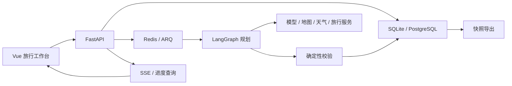

# Rovia 架构

Vue 3、Pinia 与 Vite 提供登录、旅行工作台、行程详情和运行监控。FastAPI 提供账户、业务与流式进度接口，SQLAlchemy 保存数据，Alembic 管理迁移。Redis 与 ARQ 执行异步任务，LangGraph 组织需求澄清、检索、路线安排与校验。

## 数据与操作

`Trip` 是行程的规范结果，包含需求、日期、地点、每日路线、活动、来源和风险提示。模型定义见 `backend/app/domain/models.py`，共享 JSON Schema 在 `shared/schemas/`。

编辑通过 `PlanPatch` 预览影响，再应用、拒绝或回滚；涉及重新规划的改动必须先确认。版本保存行程与规划状态，恢复时一起还原。附件先上传、提取预览，再由用户确认地点。所有导出使用同一份冻结快照。

## 必须保持的行为

- 语义服务失败时停止自动规划，明确展示问题与重试入口。
- 未获得真实道路时，不把连线当作已确认导航路线；缺少班次、票价或补能证据时保持未知或估算标记。
- SOC 连续性、补能上限、驾驶时长、餐饮住宿与返程闭环等校验独立于模型输出。
- 账户使用密码哈希和会话 Cookie；行程、车辆、文件、版本、任务及调用记录按用户隔离。运行监控需要管理员权限。
- 日志、SSE 与导出不包含服务密钥或模型私有推理。上传检查类型、大小与实际文件内容；文件清理只处理上传根目录内的数据。
- 删除行程时清理关联文件、版本、任务及记录，运行中的任务识别删除状态。

技能资源在 `Skills/`；其第三方说明及公共服务地址属于功能依赖。业务集成在 `backend/app/skills/`，运行状态与调用记录用于区分可用、未配置、失败及降级结果。
